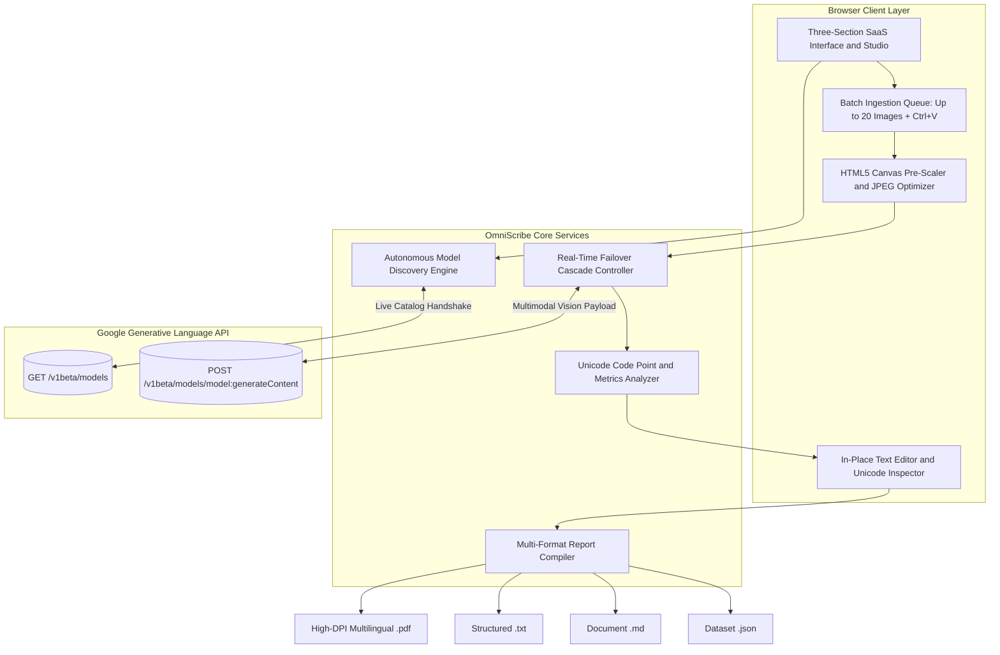

# OmniScribe: Multimodal Vision OCR and Unicode Extractor

**Academic and Engineering Portfolio Project for the Russian Government Scholarship (Open Doors / Россотрудничество)**  
**Field of Study:** Computer Science, Artificial Intelligence, and Multimodal Natural Language Processing  
**Author:** [Adel Mohamed](https://github.com/Adel-dev-2001)  
**Live Deployment:** [adel-dev-2001.github.io/omniscribe](https://adel-dev-2001.github.io/omniscribe/)  
**Repository:** [github.com/Adel-dev-2001/omniscribe](https://github.com/Adel-dev-2001/omniscribe)  
**License:** [MIT License](LICENSE)  
**Release:** v2.4.1

---

[](https://react.dev/)
[](https://www.typescriptlang.org/)
[](https://vitejs.dev/)
[](https://tailwindcss.com/)
[](https://ai.google.dev/)
[](LICENSE)
[](https://education-in-russia.com/)

---

## Table of Contents

1. [Executive Summary and Research Motivation](#1-executive-summary-and-research-motivation)
2. [Candidate Academic Note and Learning Context](#2-candidate-academic-note-and-learning-context)
3. [Russian Academic Abstract (Аннотация)](#3-russian-academic-abstract-аннотация)
4. [System Architecture and Data Pipeline](#4-system-architecture-and-data-pipeline)
5. [Forward-Compatible Autonomous Model Discovery](#5-forward-compatible-autonomous-model-discovery)
6. [Multilingual Typography and High-DPI PDF Compilation](#6-multilingual-typography-and-high-dpi-pdf-compilation)
7. [Technical Comparison: Multimodal Vision vs. Classical OCR](#7-technical-comparison-multimodal-vision-vs-classical-ocr)
8. [Project Directory Structure](#8-project-directory-structure)
9. [Security and Zero-Knowledge Client Architecture](#9-security-and-zero-knowledge-client-architecture)
10. [Local Development, Testing, and Deployment](#10-local-development-testing-and-deployment)
11. [Release History](#11-release-history)

---

## 1. Executive Summary and Research Motivation

**OmniScribe** is a client-side multimodal document intelligence application engineered to address character degradation and semantic loss in traditional Optical Character Recognition (OCR) workflows.

Conventional OCR engines (such as Tesseract and legacy CNN-based pipelines) rely on isolated glyph segmentation. Consequently, they frequently fail when processing multi-script documents combining Latin, Cyrillic, and right-to-left Arabic scripts, and they systematically strip or corrupt Unicode emojis, Zero-Width Joiner (ZWJ) sequences, mathematical notation, and tabular layouts.

OmniScribe replaces brittle glyph segmentation with direct multimodal vision inference over the Google Gemini REST API:

1. **Full Unicode and Emoji Preservation:** Captures standard scripts alongside complex emoji sequences, regional indicator flags, skin-tone modifiers, and technical symbols directly into canonical Unicode code points.
2. **Perpetual Free-Tier Model Discovery:** Dynamically queries Google's live `/v1beta/models` endpoint at runtime, filtering strictly for active Free-Tier multimodal Flash models and automatically binding to the newest available generation without hardcoded model obsolescence.
3. **Live Failover Cascade:** Monitors HTTP response codes during batch inference and automatically transitions across verified free-tier models if per-minute rate limits (`HTTP 429`) or endpoint deprecations occur.
4. **High-Fidelity Batch Consolidation:** Processes up to 20 images per batch (via drag-and-drop, file selection, or direct `Ctrl+V` clipboard capture) and compiles results into structured Plain Text (`.txt`), high-DPI multilingual PDF (`.pdf`), Markdown (`.md`), or machine-readable JSON datasets (`.json`).

---

## 2. Candidate Academic Note and Learning Context

> **Note to the Scholarship Evaluation Committee:**  
> This repository was developed by [**Adel Mohamed**](https://github.com/Adel-dev-2001) as part of an ongoing self-directed learning journey into modern software engineering, artificial intelligence integration, and real-time REST API orchestration.  
>  
> Building this system served as a practical laboratory for studying how client-side web applications interact with cloud-hosted multimodal vision models, handle asynchronous rate-limiting cascades, and solve cross-lingual Unicode rendering challenges across Arabic, Russian, and English scripts. As an applicant for the **Russian Government Scholarship in Computer Science and Artificial Intelligence**, I present this work as an honest reflection of my current technical progress and hands-on experimentation with AI development tools. Because software engineering is an iterative discipline, certain architectural patterns in this project may still have room for deeper optimization as my theoretical foundation grows. I welcome technical critique and academic mentorship from university faculty in the Russian Federation to advance my skills from applied prototyping to rigorous computer science research.

---

## 3. Russian Academic Abstract (Аннотация)

> **Направление подготовки:** 09.04.01 Информатика и вычислительная техника / Искусственный интеллект и мультимодальный анализ данных  
> **Автор:** Adel Mohamed ([github.com/Adel-dev-2001](https://github.com/Adel-dev-2001))  
> **Целевые вузы:** НИУ ВШЭ, Университет ИТМО, МФТИ, МГУ им. М.В. Ломоносова  
> **Тема проекта:** Клиентская мультимодальная система оптического распознавания текста и символов Unicode с динамической адаптацией к актуальным моделям машинного зрения.

### Основные инженерные решения:
1. **Динамическое обнаружение моделей (Autonomous Model Discovery):** Отказ от статической привязки к устаревающим версиям API. Модуль интроспекции опрашивает эндпоинт `GET /v1beta/models`, фильтрует бесплатные мультимодальные модели семейства Flash и ранжирует их по номеру поколения (`major.minor`), обеспечивая прямую совместимость с будущими релизами.
2. **Отказоустойчивый каскад (Live Failover Cascade):** При возникновении минутных ограничений квоты (`HTTP 429`) система автоматически переключает поток задач на резервную модель актуального поколения без прерывания пакетной очереди.
3. **Многоязычный векторно-растровый экспорт:** Поддержка кириллицы, арабской вязи (RTL) и латиницы с рендерингом документов в PDF высокого разрешения (192 DPI), структурированный текст (`.txt`), Markdown (`.md`) и JSON (`.json`).

---

## 4. System Architecture and Data Pipeline



### Image Pre-Processing and Transmission Optimization
Before transmitting an image to the vision endpoint, `src/utils/imageProcessor.ts` processes the file locally using an off-screen HTML5 Canvas:
- Images exceeding `1280px` on their longest edge are proportionally scaled down with high-quality bicubic interpolation (`imageSmoothingQuality = 'high'`).
- Payloads are encoded into normalized JPEG streams (`0.82` quality), reducing base64 network transmission size by up to 85% while preserving character edge sharpness for sub-second inference.

---

## 5. Forward-Compatible Autonomous Model Discovery

Hardcoding model identifiers in client applications causes software failure whenever cloud providers retire legacy model versions (such as `gemini-1.0` or `gemini-1.5`).

OmniScribe implements a version-agnostic discovery algorithm in [`src/services/geminiService.ts`](src/services/geminiService.ts):

1. **Live Catalog Introspection:** Queries `https://generativelanguage.googleapis.com/v1beta/models?key=<API_KEY>` directly from the client browser.
2. **Strict Free-Tier Filtering:** Retains only models that support `generateContent` and belong to the Free-Tier multimodal Flash families (`flash` and `flash-lite`). Paid tiers (`pro`, `ultra`, `argon`), specialized non-OCR models (`tts`, `audio`, `imagen`, `veo`, `embedding`, `thinking`), date-pinned snapshots, and retired `1.x` versions are systematically excluded.
3. **Generation Version Parsing:** Extracts numerical `major` and `minor` version components via regular expression matching (`gemini-(\d+)(?:\.(\d+))?`). Whether the catalog exposes version `2.5`, `3.x`, `4.x`, or any future generation, the comparator ranks the highest generation first.
4. **Synchronous Batch Failover:** If the primary model encounters a rate limit or parameter mismatch during batch extraction, the engine retries automatically across the next highest discovered free model and updates the active session binding in real time.

---

## 6. Multilingual Typography and High-DPI PDF Compilation

Standard client-side PDF libraries (such as default `jsPDF` text methods) rely on 8-bit WinAnsi/Latin-1 encoding, which corrupts Arabic right-to-left (RTL) contextual ligatures, Russian Cyrillic characters, and multi-byte Unicode emojis.

To solve this without server-side dependencies, [`src/services/exportService.ts`](src/services/exportService.ts) implements a hybrid DOM-to-Canvas-to-PDF pipeline:
- Constructs an isolated, print-styled A4 layout container rendered through the browser's native HarfBuzz/DirectWrite text-shaping engine (`Cairo`, `Inter`, and native color emoji fonts).
- Automatically detects Arabic script ranges (`\u0600-\u06FF`) per paragraph to apply contextual `dir="rtl"` alignment alongside `dir="ltr"` blocks for Russian and English.
- Rasterizes pages at `2x` device pixel ratio (`192 DPI`) via `html2canvas` and slices multi-page documents across standard A4 dimensions (`210mm x 297mm`) with protective page-break padding so text lines are never clipped mid-character.

---

## 7. Technical Comparison: Multimodal Vision vs. Classical OCR

| Evaluation Criterion | Classical OCR (Tesseract / Legacy Pipelines) | OmniScribe (Multimodal Vision Architecture) |
| :--- | :--- | :--- |
| **Unicode Emojis and Symbols** | Omitted or misclassified as punctuation noise | Full preservation of Unicode code points and ZWJ sequences |
| **Multilingual Mixed Scripts** | Requires manual language pack configuration | Native recognition of English, Russian, and Arabic in a single pass |
| **Tabular and Code Layouts** | Loses column alignment and indentation | Preserves spatial structure, Markdown tables, and code blocks |
| **Model Lifecycle Longevity** | Static weights or hardcoded API model names | Dynamic runtime discovery of newest Free-Tier Flash models |
| **Batch Report Compilation** | Requires external post-processing scripts | Built-in client-side export to PDF, TXT, Markdown, and JSON |
| **Data Privacy Boundary** | Often requires backend server file uploads | Zero-knowledge browser execution; direct Google API TLS connection |

---

## 8. Project Directory Structure

```text
omniscribe/
├── .github/
│   └── workflows/
│       └── deploy.yml             # Automated CI/CD pipeline for GitHub Pages deployment
├── public/
│   └── favicon.svg                # Geometric optical aperture vector icon
├── src/
│   ├── __tests__/
│   │   └── coreEngine.test.ts     # Automated unit tests for NLP metrics, exports, and model discovery
│   ├── components/
│   │   ├── BatchControls.tsx      # Queue metrics bar and batch execution controls
│   │   ├── BatchDropzone.tsx      # Drag-and-drop and clipboard ingestion component (max 20 files)
│   │   ├── ExportModal.tsx        # Multi-format compilation configuration dialog
│   │   ├── Header.tsx             # Floating navigation bar, live model pill, and language switcher
│   │   ├── ImagePreviewList.tsx   # Queue cards with optical laser scanning overlay
│   │   ├── Logo.tsx               # Scalable SVG brand mark component
│   │   ├── ModelSelectorModal.tsx # API key management and live Google catalog scanner
│   │   ├── ResultModal.tsx        # Inspection dialog, in-place editor, and Unicode code-point inspector
│   │   ├── SaaSFaq.tsx            # Technical architecture and privacy accordion
│   │   ├── SaaSFeatures.tsx       # Core architectural capabilities grid
│   │   ├── SaaSFooter.tsx         # Minimal single-line attribution footer
│   │   └── SaaSHero.tsx           # Hero section and quantitative performance indicators
│   ├── i18n/
│   │   └── translations.ts        # Complete trilingual localization dictionaries (EN, RU, AR)
│   ├── services/
│   │   ├── exportService.ts       # Client-side PDF, TXT, Markdown, and JSON compilation service
│   │   └── geminiService.ts       # Google Gemini REST client, model discovery, and failover engine
│   ├── types/
│   │   └── index.ts               # Strict TypeScript interfaces and data contracts
│   ├── utils/
│   │   └── imageProcessor.ts      # HTML5 Canvas image downscaling and compression utility
│   ├── App.tsx                    # Root application state, batch queue controller, and keyboard listeners
│   ├── index.css                  # Tailwind CSS layers, custom scrollbars, and laser scan keyframes
│   └── main.tsx                   # React 18 DOM entry point
├── index.html                     # SEO meta tags, OpenGraph cards, and Schema.org JSON-LD graph
├── LICENSE                        # MIT Open-Source License
├── package.json                   # Project dependencies and build scripts
├── tailwind.config.js             # Tailwind CSS theme and typography configuration
├── tsconfig.json                  # Strict TypeScript compiler configuration
└── vite.config.ts                 # Vite bundler configuration with relative base paths
```

---

## 9. Security and Zero-Knowledge Client Architecture

1. **Direct Browser-to-Google Communication:** OmniScribe operates entirely as a client-side Single Page Application (SPA). All API requests are transmitted directly from the user's browser over HTTPS to `generativelanguage.googleapis.com`.
2. **Local Credential Isolation:** The user's Google Gemini API key is stored exclusively in the browser's local storage (`localStorage`) and can be wiped with a single click. No backend database, proxy server, or telemetry service ever receives the key.
3. **Ephemeral Document Processing:** Uploaded images are processed in volatile browser memory (`FileReader` / `HTML5 Canvas`) and are cleared immediately upon queue reset or tab closure.

---

## 10. Local Development, Testing, and Deployment

### Prerequisites
- **Node.js:** v18.0.0 or higher (verified on Node.js v20 and v24)
- **Package Manager:** `npm` (v9+)
- **API Credential:** Free-tier Google Gemini API key from [Google AI Studio](https://aistudio.google.com/)

### Installation and Commands
```bash
# 1. Clone the repository
git clone https://github.com/Adel-dev-2001/omniscribe.git
cd omniscribe

# 2. Install dependencies
npm install

# 3. Run automated unit test suite (Vitest)
npm test

# 4. Launch local development server
npm run dev

# 5. Compile production bundle
npm run build
```

---

## 11. Release History

### v2.4.1 (Current Release)
- Refined the autonomous model discovery filter (`selectNewestFreeModels`) to strictly target active Free-Tier multimodal Flash families (`flash` and `flash-lite`), excluding paid tiers, non-vision endpoints, and date-pinned preview snapshots.
- Added synchronous React ref state tracking during batch extraction so live model failover persists immediately across all queued images.
- Implemented high-DPI DOM-to-Canvas-to-PDF rendering (`192 DPI`) with full right-to-left Arabic ligature shaping, Cyrillic support, and native color emoji preservation.
- Added optical laser scanner animation overlay on active image cards during vision inference.
- Enriched `index.html` with Schema.org JSON-LD (`SoftwareApplication` and `WebSite` graphs), OpenGraph metadata, and relative asset paths for GitHub Pages deployment.

### v2.3.0
- Streamlined the user interface into a focused three-section layout (Hero and Studio Workspace, Core Capabilities, and Technical FAQ) with full dark/light mode persistence.
- Added global `Ctrl+V` clipboard image capture, modal background scroll locking, and `Escape` key dismissal.
- Integrated non-intrusive quota alert notifications and one-click API key management.

### v2.0.0
- Added in-place OCR text editing with real-time recalculation of character, word, line, and emoji statistics.
- Added interactive Unicode emoji chip inspector displaying hexadecimal code points (`U+XXXX`).
- Completed trilingual localization across English (`en`), Russian (`ru`), and Arabic (`ar`) with automatic RTL/LTR layout switching.

### v1.0.0
- Initial architecture featuring batch image ingestion (up to 20 files), dynamic Google Gemini API discovery, and consolidated multi-format export (`.txt`, `.pdf`, `.md`, `.json`).

---

**Author:** [Adel Mohamed](https://github.com/Adel-dev-2001) • Released under the [MIT License](LICENSE).
