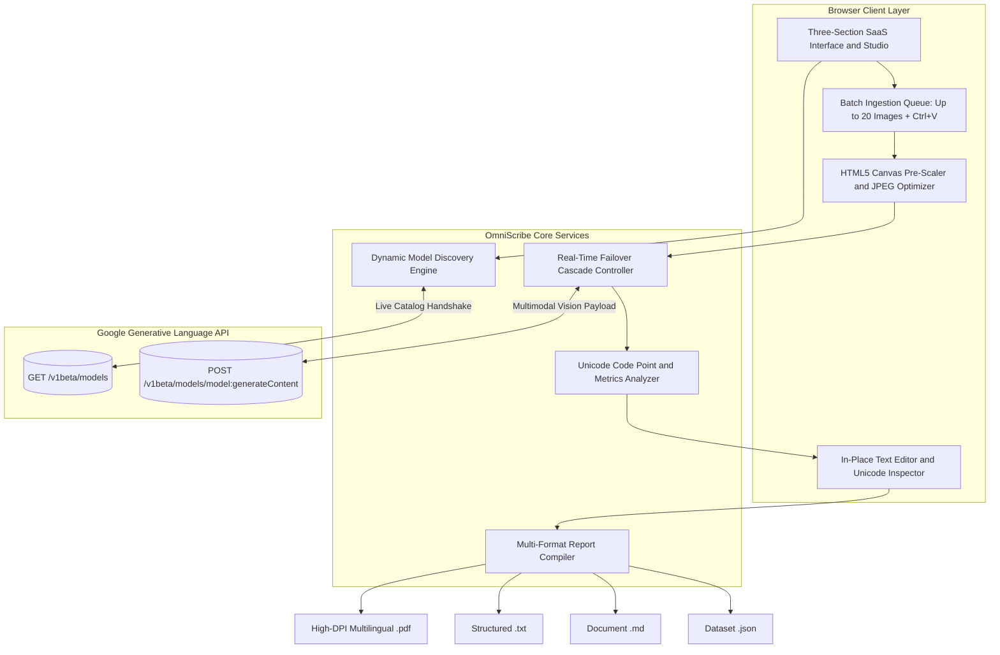

# OmniScribe: Multimodal Vision OCR and Unicode Extractor

**Academic and Engineering Portfolio Project for the Russian Government Scholarship (Open Doors / Россотрудничество)**  
**Field of Study:** Computer Science, Artificial Intelligence, and Multimodal Natural Language Processing  
**Author:** [Adel Mohamed](https://github.com/Adel-dev-2001)  
**Live Deployment:** [adel-dev-2001.github.io/omniscribe](https://adel-dev-2001.github.io/omniscribe/)  
**Repository:** [github.com/Adel-dev-2001/omniscribe](https://github.com/Adel-dev-2001/omniscribe)  
**License:** [MIT License](LICENSE)  
**Release:** v2.4.1

---

[](https://react.dev/)
[](https://www.typescriptlang.org/)
[](https://vitejs.dev/)
[](https://tailwindcss.com/)
[](https://ai.google.dev/)
[](LICENSE)
[](https://education-in-russia.com/)

---

## Table of Contents

1. [Executive Summary and Research Motivation](#1-executive-summary-and-research-motivation)
2. [Candidate Academic Note and Learning Context](#2-candidate-academic-note-and-learning-context)
3. [Russian Academic Abstract (Аннотация)](#3-russian-academic-abstract-аннотация)
4. [System Architecture and Data Pipeline](#4-system-architecture-and-data-pipeline)
5. [Forward-Compatible Dynamic Model Discovery](#5-forward-compatible-dynamic-model-discovery)
6. [Multilingual Typography and High-DPI PDF Compilation](#6-multilingual-typography-and-high-dpi-pdf-compilation)
7. [Technical Comparison: Multimodal Vision vs. Classical OCR](#7-technical-comparison-multimodal-vision-vs-classical-ocr)
8. [Project Directory Structure](#8-project-directory-structure)
9. [Security and Client-Side Architecture](#9-security-and-client-side-architecture)
10. [Local Development, Testing, and Deployment](#10-local-development-testing-and-deployment)
11. [Release History](#11-release-history)

---

## 1. Executive Summary and Research Motivation

**OmniScribe** is a client-side multimodal document intelligence application engineered to address character degradation and semantic loss in traditional Optical Character Recognition (OCR) workflows.

Conventional OCR engines (such as Tesseract and legacy CNN-based pipelines) rely on isolated glyph segmentation. Consequently, they frequently fail when processing multi-script documents combining Latin, Cyrillic, and right-to-left Arabic scripts, and they systematically strip or corrupt Unicode emojis, Zero-Width Joiner (ZWJ) sequences, mathematical notation, and tabular layouts.

OmniScribe replaces brittle glyph segmentation with direct multimodal vision inference over the Google Gemini REST API:

1. **Unicode and Emoji Preservation:** Captures standard scripts alongside complex emoji sequences, regional indicator flags, skin-tone modifiers, and technical symbols directly into canonical Unicode code points.
2. **Dynamic Free-Tier Model Discovery:** Queries Google's live `/v1beta/models` endpoint at runtime, filters for active Free-Tier multimodal Flash models, and binds to the newest available generation without hardcoded model IDs.
3. **Live Failover Cascade:** Monitors HTTP response codes during batch inference and transitions across verified free-tier models when per-minute rate limits (`HTTP 429`) or endpoint deprecations occur.
4. **Consolidated Batch Exports:** Processes up to 20 images per batch (via drag-and-drop, file selection, or `Ctrl+V` clipboard capture) and compiles results into Plain Text (`.txt`), high-DPI multilingual PDF (`.pdf`), Markdown (`.md`), or structured JSON (`.json`).

---

## 2. Candidate Academic Note and Learning Context

> **Note to the Scholarship Evaluation Committee:**  
> I developed [**OmniScribe**](https://github.com/Adel-dev-2001/omniscribe) as part of an ongoing self-directed study in modern web engineering, cloud API orchestration, and multimodal document processing.  
>  
> Building this application served as a practical exercise in interacting directly with cloud-hosted vision models from a browser client, handling rate-limit failovers cleanly, and solving cross-lingual Unicode rendering challenges across Arabic, Russian, and English scripts. As an applicant for the **Russian Government Scholarship in Computer Science and Artificial Intelligence**, I present this repository as a transparent sample of my current engineering work. Because software engineering is an iterative craft, I welcome technical feedback and academic mentorship from university faculty in the Russian Federation to strengthen my theoretical foundations further.

---

## 3. Russian Academic Abstract (Аннотация)

> **Направление подготовки:** 09.04.01 Информатика и вычислительная техника / Искусственный интеллект и мультимодальный анализ данных  
> **Автор:** Adel Mohamed ([github.com/Adel-dev-2001](https://github.com/Adel-dev-2001))  
> **Целевые вузы:** НИУ ВШЭ, Университет ИТМО, МФТИ, МГУ им. М.В. Ломоносова  
> **Тема проекта:** Клиентская мультимодальная система оптического распознавания текста и символов Unicode с динамической адаптацией к актуальным моделям машинного зрения.

### Основные инженерные решения:
1. **Динамическое обнаружение моделей (Dynamic Model Discovery):** Отказ от статической привязки к устаревающим версиям API. Модуль интроспекции выполняет постраничный опрос эндпоинта `GET /v1beta/models` (`pageSize=1000`, `nextPageToken`) с передачей ключа в HTTP-заголовке `x-goog-api-key`, фильтрует бесплатные мультимодальные модели семейства Flash и ранжирует их по номеру поколения (`major.minor`), сохраняя совместимость с будущими релизами.
2. **Отказоустойчивый каскад и изоляция промпта:** При возникновении минутных ограничений квоты (`HTTP 429`) или неподдерживаемых параметров система автоматически переключается на резервную модель актуального поколения без прерывания очереди. Инструкции транскрипции передаются через `systemInstruction` (с откатом к одношаговому формату при `HTTP 400`).
3. **Многоязычный растрово-векторный экспорт:** Поддержка кириллицы, арабской вязи (RTL) и латиницы с рендерингом документов в PDF высокого разрешения (192 DPI), а также экспорт в `.txt`, `.md` и `.json`.

---

## 4. System Architecture and Data Pipeline



### Image Pre-Processing and Transmission Optimization
Before transmitting an image to the vision endpoint, `src/utils/imageProcessor.ts` processes the file locally using an off-screen HTML5 Canvas:
- Images exceeding `1280px` on their longest edge are proportionally scaled down with high-quality bicubic interpolation (`imageSmoothingQuality = 'high'`).
- Payloads are encoded into normalized JPEG streams (`0.85` quality), reducing base64 network transmission size while preserving character edge sharpness for sub-second inference.

---

## 5. Forward-Compatible Dynamic Model Discovery

Hardcoding model identifiers in client applications causes software failure whenever cloud providers retire legacy model versions (such as `gemini-1.0` or `gemini-1.5`).

OmniScribe implements a version-agnostic discovery and inference pipeline in [`src/services/geminiService.ts`](src/services/geminiService.ts):

1. **Paginated Live Catalog Introspection:** Queries `https://generativelanguage.googleapis.com/v1beta/models?pageSize=1000` (following `nextPageToken` cursors up to 5 pages) directly from the browser using HTTP header authentication (`x-goog-api-key`), keeping credentials out of request URLs.
2. **Strict Free-Tier Filtering:** Retains only models that support `generateContent` and belong to the Free-Tier multimodal Flash families (`flash` and `flash-lite`). Paid tiers (`pro`, `ultra`, `argon`, `carbon`, `hydrogen`), specialized non-OCR models (`tts`, `audio`, `imagen`, `veo`, `embedding`, `thinking`), date-pinned snapshots (`versionSuffix` matching so future 4-digit major versions like `gemini-1000-flash` are preserved), and retired `1.x` versions are excluded.
3. **Generation Version Parsing:** Extracts numerical `major` and `minor` version components via regular expression matching (`gemini-(\d+)(?:\.(\d+))?`). Whether the catalog exposes version `2.5`, `3.8`, `4.x`, or any future generation, the comparator ranks the highest generation first.
4. **Prompt Isolation and Synchronous Failover:** Transmits verbatim OCR directives via `systemInstruction` (strictly separating instructions from untrusted user image bytes) with an automatic single-turn `HTTP 400` compatibility fallback and real-time `HTTP 429` model cascade failover across verified Free-Tier Flash endpoints.

---

## 6. Multilingual Typography and High-DPI PDF Compilation

Standard client-side PDF libraries (such as default `jsPDF` text methods) rely on 8-bit WinAnsi/Latin-1 encoding, which corrupts Arabic right-to-left (RTL) contextual ligatures, Russian Cyrillic characters, and multi-byte Unicode emojis.

To solve this without server-side dependencies, [`src/services/exportService.ts`](src/services/exportService.ts) implements a hybrid DOM-to-Canvas-to-PDF pipeline:
- Constructs an isolated, print-styled A4 layout container rendered through the browser's native HarfBuzz/DirectWrite text-shaping engine (`Cairo`, `Inter`, and native color emoji fonts).
- Uses native HTML5 bidirectional text isolation (`dir="auto"` paired with CSS `unicode-bidi: plaintext` and `text-align: start`) so Arabic right-to-left (RTL) paragraphs and Russian Cyrillic or English left-to-right (LTR) blocks shape and align naturally within the same report.
- Rasterizes pages at `2x` device pixel ratio (`192 DPI`) via `html2canvas` and slices multi-page documents across standard A4 dimensions (`210mm x 297mm`) with immediate intermediate Canvas buffer reclamation after each page.

---

## 7. Technical Comparison: Multimodal Vision vs. Classical OCR

| Evaluation Criterion | Classical OCR (Tesseract / Legacy Pipelines) | OmniScribe (Multimodal Vision Architecture) |
| :--- | :--- | :--- |
| **Unicode Emojis and Symbols** | Omitted or misclassified as punctuation noise | Full preservation of Unicode code points and ZWJ sequences |
| **Multilingual Mixed Scripts** | Requires manual language pack configuration | Native recognition of English, Russian, and Arabic in a single pass |
| **Tabular and Code Layouts** | Loses column alignment and indentation | Preserves spatial structure, Markdown tables, and code blocks |
| **Model Lifecycle Longevity** | Static weights or hardcoded API model names | Dynamic runtime discovery of newest Free-Tier Flash models |
| **Batch Report Compilation** | Requires external post-processing scripts | Built-in client-side export to PDF, TXT, Markdown, and JSON |
| **Data Privacy Boundary** | Often requires backend server file uploads | Client-side execution; direct browser-to-Google HTTPS connection |

---

## 8. Project Directory Structure

```text
omniscribe/
├── .github/
│   └── workflows/
│       └── deploy.yml             # Automated CI/CD pipeline for GitHub Pages deployment
├── public/
│   └── favicon.svg                # Geometric optical aperture vector icon
├── src/
│   ├── __tests__/
│   │   └── coreEngine.test.ts     # Automated unit tests for NLP metrics, exports, discovery, and failover
│   ├── components/
│   │   ├── BatchControls.tsx      # Queue metrics bar and batch execution controls
│   │   ├── BatchDropzone.tsx      # Drag-and-drop and clipboard ingestion component (max 20 files)
│   │   ├── ExportModal.tsx        # Multi-format compilation configuration dialog
│   │   ├── Header.tsx             # Floating navigation bar, live model pill, and language switcher
│   │   ├── ImagePreviewList.tsx   # Queue cards with optical laser scanning overlay
│   │   ├── Logo.tsx               # Scalable SVG brand mark component
│   │   ├── ModelSelectorModal.tsx # API key management and live Google catalog scanner
│   │   ├── ResultModal.tsx        # Inspection dialog, in-place editor, and Unicode code-point inspector
│   │   ├── SaaSFaq.tsx            # Technical architecture and privacy accordion
│   │   ├── SaaSFeatures.tsx       # Core architectural capabilities grid
│   │   ├── SaaSFooter.tsx         # Minimal single-line attribution footer
│   │   └── SaaSHero.tsx           # Hero section and quantitative performance indicators
│   ├── i18n/
│   │   └── translations.ts        # Complete trilingual localization dictionaries (EN, RU, AR)
│   ├── services/
│   │   ├── exportService.ts       # Client-side PDF, TXT, Markdown, and JSON compilation service
│   │   └── geminiService.ts       # Google Gemini REST client, model discovery, and failover engine
│   ├── types/
│   │   └── index.ts               # Strict TypeScript interfaces and data contracts
│   ├── utils/
│   │   └── imageProcessor.ts      # HTML5 Canvas image downscaling and compression utility
│   ├── App.tsx                    # Root application state, batch queue controller, and keyboard listeners
│   ├── index.css                  # Tailwind CSS layers, custom scrollbars, and laser scan keyframes
│   └── main.tsx                   # React 18 DOM entry point
├── .gitignore                     # Git ignore rules for dependencies, builds, and environment files
├── LICENSE                        # MIT Open-Source License
├── README.md                      # Technical architecture specification and academic documentation
├── index.html                     # SEO meta tags, OpenGraph cards, and Schema.org JSON-LD graph
├── package-lock.json              # Locked deterministic npm dependency tree
├── package.json                   # Project dependencies and build scripts
├── postcss.config.js              # PostCSS pipeline configuration
├── tailwind.config.js             # Tailwind CSS theme and typography configuration
├── tsconfig.json                  # Strict TypeScript compiler configuration
├── tsconfig.node.json             # TypeScript compiler settings for Node/Vite build tooling
└── vite.config.ts                 # Vite bundler configuration with relative base paths
```

---

## 9. Security and Client-Side Architecture

1. **Direct Browser-to-Google Communication:** OmniScribe operates entirely as a client-side Single Page Application (SPA). All API requests are transmitted directly from the user's browser over HTTPS to `generativelanguage.googleapis.com`.
2. **HTTP Header Authentication and Secret Redaction:** Credentials are transmitted exclusively via the `x-goog-api-key` HTTP request header rather than URL query parameters, preventing key leakage in browser history or server access logs. Any API key strings echoed in upstream error responses are redacted before surfacing diagnostics.
3. **Local Credential Isolation and Output Sanitization:** The user's Google Gemini API key is stored locally in `localStorage` with single-click deletion, no third-party proxy ever inspects traffic, uploaded images stay in volatile browser memory (`FileReader` and `HTML5 Canvas`), and PDF DOM templates escape untrusted text (`escapeHtml`) while sanitizing export filenames (`safeFileSlug`).

---

## 10. Local Development, Testing, and Deployment

### Prerequisites
- **Node.js:** v22.12.0+ or v24.x (required by Vitest 5; verified on Node.js v24.18)
- **Package Manager:** `npm` (v10+)
- **API Credential:** Free-tier Google Gemini API key from [Google AI Studio](https://aistudio.google.com/)

### Installation and Commands
```bash
# 1. Clone the repository
git clone https://github.com/Adel-dev-2001/omniscribe.git
cd omniscribe

# 2. Install dependencies
npm install

# 3. Verify strict TypeScript types
npm run typecheck

# 4. Run automated unit test suite (Vitest)
npm test

# 5. Launch local development server
npm run dev

# 6. Compile production bundle
npm run build
```

> **Continuous Integration:** Pushing to `main` triggers [`.github/workflows/deploy.yml`](.github/workflows/deploy.yml), which executes `npm ci`, `npm run typecheck`, `npm test`, and `npm run build` before publishing `./dist` to GitHub Pages.

---

## 11. Release History

### v2.4.1 (Current Release)
- Upgraded Gemini REST authentication to the `x-goog-api-key` HTTP header across model discovery and multimodal inference, added `nextPageToken` catalog pagination (`pageSize=1000`), redacted credentials on upstream errors, and fixed auto-discovery key validation so invalid keys do not re-trigger background scans in a loop.
- Added `systemInstruction` prompt isolation with single-turn `HTTP 400` fallback, version-suffix regex filtering to protect future multi-digit major releases (such as `gemini-1000-flash`), and synchronous React ref failover persistence alongside React StrictMode-safe state updates and guarded `localStorage` access.
- Replaced rigid edge-to-edge borders with subtle `.section-divider` hairlines, updated Tailwind v3 button/card shadows, wired `AbortController` batch cancellation with `blob:` URL cleanup, cleaned up modal/copy timers on unmount, and expanded dialog/tab/group/accordion ARIA accessibility.
- Completed trilingual localization (`EN`/`RU`/`AR`), multi-codepoint Unicode inspection, and inline error reporting for both batch queues and single-item PDF generation.
- Refined high-DPI DOM-to-Canvas-to-PDF compilation (`192 DPI`) with HTML entity escaping, native `dir="auto"` BiDi alignment, dynamic Markdown code fences with TOC bracket escaping, safe filename slugs, Canvas memory reclamation, and updated GitHub Actions CI to Node.js 24 alongside an expanded Vitest unit suite.
- Enriched `index.html` with Schema.org JSON-LD (`SoftwareApplication` and `WebSite`), strict referrer metadata, accessible `<noscript>` fallback, and relative `./` asset paths for GitHub Pages deployment.

### v2.3.0
- Streamlined the user interface into a focused three-section layout (Hero and Studio Workspace, Core Capabilities, and Technical FAQ) with full dark/light mode persistence.
- Added global `Ctrl+V` clipboard image capture, modal background scroll locking, and `Escape` key dismissal.
- Integrated non-intrusive quota alert notifications and one-click API key management.

### v2.0.0
- Added in-place OCR text editing with real-time recalculation of character, word, line, and emoji statistics.
- Added interactive Unicode emoji chip inspector displaying hexadecimal code points (`U+XXXX`).
- Completed trilingual localization across English (`en`), Russian (`ru`), and Arabic (`ar`) with automatic RTL/LTR layout switching.

### v1.0.0
- Initial architecture featuring batch image ingestion (up to 20 files), dynamic Google Gemini API discovery, and consolidated multi-format export (`.txt`, `.pdf`, `.md`, `.json`).

---

**Author:** [Adel Mohamed](https://github.com/Adel-dev-2001) • Released under the [MIT License](LICENSE).
