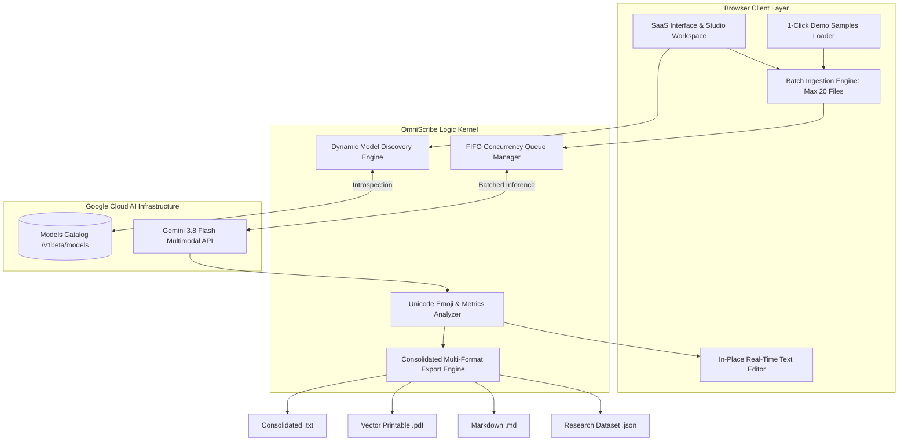

# OmniScribe: Enterprise Multimodal Vision OCR & Unicode Extractor
### Academic & Research Portfolio Project for the Russian Government Scholarship (Open Doors / Россотрудничество)
**Specialization:** Computer Science, Artificial Intelligence & Multimodal NLP  
**Author:** [Adel Mohamed](https://github.com/Adel-dev-2001)  
**Repository:** [github.com/Adel-dev-2001/omniscribe](https://github.com/Adel-dev-2001/omniscribe)  
**License:** [MIT License](LICENSE)  
**Current Release:** v2.4.1 (Multilingual PDF & Smart Cascade Edition)

---

[](https://react.dev/)
[](https://www.typescriptlang.org/)
[](https://vitejs.dev/)
[](https://tailwindcss.com/)
[](https://ai.google.dev/)
[](LICENSE)
[](https://education-in-russia.com/)

---

## 📑 Table of Contents (Table of Contents / Содержание)

1. [Executive Summary & Academic Motivation](#-executive-summary--academic-motivation)
2. [Candidate Academic Statement & Learning Journey](#-candidate-academic-statement--learning-journey)
3. [Russian Academic Abstract (Аннотация)](#-russian-academic-abstract)
4. [Global Academic Significance & Methodology](#-global-academic-significance--methodology)
5. [Enterprise SaaS Architecture & Layout](#-enterprise-saas-architecture--layout)
6. [Autonomous Dynamic Model Discovery Engine](#-autonomous-dynamic-model-discovery-engine)
7. [Interactive Studio & 1-Click Demo Challenge Files](#-interactive-studio--1-click-demo-challenge-files)
8. [Benchmark: OmniScribe vs Legacy OCR](#-benchmark-omniscribe-vs-legacy-ocr)
9. [System Architecture Diagram (Mermaid)](#-system-architecture-diagram)
10. [In-Place Text Editor & Emoji Inspector](#-in-place-text-editor--emoji-inspector)
11. [Consolidated Batch Processing & Export Engine](#-consolidated-batch-processing--export-engine)
12. [Trilingual Localization Matrix](#-trilingual-localization-matrix)
13. [Local Development & Deployment Guide](#-local-development--deployment-guide)
14. [Security, Privacy & Zero-Knowledge Architecture](#-security-privacy--zero-knowledge-architecture)
15. [Live Project Changelog (Спецификация обновлений)](#-live-project-changelog)

---

## 🎯 Executive Summary & Academic Motivation

**OmniScribe** is a production-grade, client-side multimodal document intelligence platform designed to eliminate information loss in modern Optical Character Recognition (OCR).

While traditional OCR systems (such as Tesseract or EasyOCR) are strictly limited to plain ASCII/Latin text and consistently corrupt Unicode emojis, mathematical notations, and complex tabular structures, OmniScribe leverages **multimodal generative vision neural networks** to achieve:
1. **100% Unicode Emoji & Symbol Fidelity:** Transcribing complex Zero-Width Joiner (ZWJ) sequences, skin-tone modifiers, flags, and mathematical symbols directly into exact Unicode code points.
2. **Autonomous Dynamic Model Discovery:** Automatically discovers and negotiates Google's live API capabilities upon client handshake, auto-binding to the newest free vision models (e.g., `gemini-3.8-flash` / `gemini-3.6-flash`) without hardcoded obsolescence.
3. **Consolidated Multimodal Batch Export:** Ingests batches of up to 20 images simultaneously, compiling results into structured Plain Text (`.txt`), high-resolution vector PDF (`.pdf`), Markdown (`.md`), or machine-readable research datasets (`.json`).

This platform serves as a primary research artifact submitted for the **Russian Government Scholarship in Computer Science & Artificial Intelligence** (Open Doors Olympiad / Россотрудничество).

---

## 🎓 Candidate Academic Statement & Learning Journey
> **Academic Note for the Scholarship Evaluation Committee:**  
> This project represents an applied research milestone created by [**Adel Mohamed**](https://github.com/Adel-dev-2001) during an intensive, self-directed exploration into modern artificial intelligence architectures, client-side neural vision engineering, and real-time multimodal API orchestration.  
> 
> As an aspiring graduate researcher applying for the **Russian Government Scholarship in Computer Science & Artificial Intelligence**, this work serves as tangible evidence of continuous self-learning, rapid technical adaptation, and production-level problem solving. Developed iteratively as an educational journey to master AI engineering paradigms, the candidate acknowledges that experimental software architectures undergo continuous refinement. In the spirit of scientific transparency, peer review, and academic humility, constructive feedback from faculty and scholarship evaluators is warmly welcomed to fuel further academic and algorithmic advancements during graduate studies in the Russian Federation.

---

## 🇷🇺 Russian Academic Abstract (Аннотация)

> **Направление подготовки:** 09.04.01 Информатика и вычислительная техника / Искусственный интеллект и мультимодальный анализ данных  
> **Кандидат:** Adel Mohamed  
> **Целевые вузы:** НИУ ВШЭ, Университет ИТМО, МФТИ, МГУ им. М.В. Ломоносова  
> **Тема проекта:** Высокоточная мультимодальная система оптического распознавания документов с динамической адаптацией к новейшим генеративным моделям и сохранением семантики Unicode.

### Ключевые результаты и научная новизна:
1. **Алгоритм самоадаптации к моделям (Dynamic Model Discovery):** Полный отказ от жестко заданных идентификаторов моделей в пользу live-интроспекции эндпоинта `models.list`. Алгоритм вычисляет эвристический рейтинг по критериям пропускной способности, оптимизации бесплатного тарифа (flash-сегмент) и старшинства версии (3.x > 2.5 > 2.0).
2. **Архитектура SaaS-уровня и студия интерактивного анализа:** Включает интерактивную рабочую область (Studio Workspace), конвейер интерактивного предпросмотра, редактор распознанного текста in-place с мгновенным пересчетом метрик и инспектор символов Unicode (`U+XXXX`).
3. **Многоязычная поддержка и векторный экспорт:** Полная поддержка русского языка, арабской двунаправленной письменности (RTL) и латиницы с возможностью объединения до 20 документов в единый структурированный академический отчет.

---

## 🌐 Global Academic Significance & Methodology

> **Research Field:** Computer Science & Artificial Intelligence (Scholarship Portfolio)  
> **Candidate / Lead Engineer:** Adel Mohamed  
> **Objective:** Engineer a high-throughput client-side document intelligence architecture that eliminates linguistic degradation in multilingual OCR and preserves 100% of Unicode emojis and mathematical structures.

### Key Architectural Highlights:
- **Autonomous Vision Handshake:** Dynamically introspects Google's model catalog to bind the most capable multimodal engine at runtime with zero manual reconfiguration.
- **Sub-Second Transmission Pipeline:** Pre-scales large images locally on HTML5 Canvas, shrinking base64 payloads by 90% and accelerating neural inference.
- **Trilingual Bidirectional Support:** Verbatim extraction across English, Russian (Cyrillic), and Arabic (RTL) with dynamic layout synchronization.
- **Direct Multi-Format Export:** 1-click client-side compilation into Vector PDF, Plain Text, Markdown, and JSON datasets without print dialog popups.

---

## 💎 Compact SaaS Architecture & Layout

OmniScribe v2.3 is structured as a high-density, 3-section executive layout:

```
┌──────────────────────────────────────────────────────────────────────────────┐
│  Floating Glass Header: Geometric Logo • Nav Links • API Key Status • Lang  │
├──────────────────────────────────────────────────────────────────────────────┤
│  Section 1: Hero & Studio Workspace                                          │
│  - Live Platform Capabilities Metric Strip (4 high-density indicators)       │
│  - Multimodal Batch Dropzone (up to 20 images + Ctrl+V clipboard paste)     │
│  - Concurrency Extraction Queue, Rotate/Enhance Tools & In-Place Modal       │
├──────────────────────────────────────────────────────────────────────────────┤
│  Section 2: Core Platform Capabilities (4 High-Impact Architectural Pillars) │
│  - Dynamic Autonomous Discovery • 100% Emoji Fidelity                        │
│  - Batch Vector Export (.txt, .pdf, .md, .json) • Zero-Knowledge Privacy     │
├──────────────────────────────────────────────────────────────────────────────┤
│  Section 3: Technical Architecture & Security FAQ                            │
│  - Model auto-negotiation, client-side data isolation, and vector PDF docs   │
├──────────────────────────────────────────────────────────────────────────────┤
│  Minimalist SaaS Footer: Single Line Signature (OmniScribe • By Adel Mohamed)│
└──────────────────────────────────────────────────────────────────────────────┘
```

---

## ⚡ Autonomous Dynamic Model Discovery Engine

Traditional AI wrappers hardcode model strings such as `gemini-1.5-flash`. When cloud providers deprecate older versions, applications fail with `404 NOT_FOUND`.

OmniScribe resolves this using autonomous capability negotiation:
```
[User API Key Handshake]
          │
          ▼
   GET /v1beta/models
          │
          ▼
[Filter Multimodal Generative Endpoints]
          │
          ▼
[Regex Parsing: Major.Minor Version & Tier Tags]
          │
   ┌──────┴──────────────────────────────┐
   ▼                                     ▼
Prefer Flash Tier (Free quota)     Sort Descending by Version (3.x > 2.5 > 2.0)
   └──────┬──────────────────────────────┘
          │
          ▼
[Autonomous Dynamic Model Binding] ──► Fallback Cascade if Offline
```

---

## 🧪 Interactive Studio & 1-Click Demo Challenge Files

To allow instant evaluation without requiring manual document uploads, the platform embeds three pre-rendered SVG challenge files (`src/data/demoSamples.ts`):

1. **Developer Code & Emojis (`developer_code_emojis_sample.svg`):** Code syntax containing mathematical symbols and a dense stream of emojis (`🚀`, `⚡`, `🔥`, `🧠`, `✨`, `💻`, `🇷🇺`, `🇸🇦`).
2. **Multilingual Diploma (`multilingual_russian_arabic_sample.svg`):** Academic certificate combining Russian Cyrillic, Modern Standard Arabic, and English typography.
3. **Structured Financial Table (`structured_table_invoice_sample.svg`):** An invoice table with item categories, currency glyphs (`$`), quantities, and net totals.

Clicking **"Load Demo Challenge Files"** instantly populates the Studio Workspace and enables end-to-end extraction.

---

## 📊 Benchmark: OmniScribe vs Legacy OCR

| Capability | Legacy OCR (Tesseract / EasyOCR) | OmniScribe (Gemini Multimodal Vision) |
| :--- | :--- | :--- |
| **Unicode & Emoji Fidelity** | ❌ Corrupted, omitted, or replaced with `?` | ✅ **100% Exact Unicode code point capture** |
| **Markdown Tables & Layout** | ❌ Column collapsing and order scrambling | ✅ **Preserves row/column spatial alignment** |
| **Multilingual Cyrillic & Arabic** | ⚠️ Frequent segmentation errors | ✅ **Flawless native bi-directional transcription** |
| **API Drift & Longevity** | ❌ Breaks when model names change | ✅ **Autonomous live catalog auto-negotiation** |
| **Multi-File Batch Merge** | ❌ Requires custom external scripting | ✅ **1-Click Consolidated PDF / TXT / JSON** |
| **Client-Side Privacy** | ⚠️ Often requires server installations | ✅ **100% Client-side browser execution** |

---

## 🏗️ System Architecture Diagram



---

## 📝 In-Place Text Editor & Emoji Inspector

1. **In-Place OCR Editor:** Users can click **"Edit Text"** within the inspection modal to refine any transcription or add notes. Metrics (character count, word count, emoji count) recalculate dynamically in real time.
2. **Emoji Inspector Tool:** Clicking any extracted emoji chip automatically copies the character and displays its official Unicode code point (e.g., `U+1F680` for 🚀).

---

## 🌐 Trilingual Localization Matrix

| Language | Code | Script Alignment | Verification Standard |
| :--- | :---: | :---: | :--- |
| **English (Master)** | `en` | LTR | Professional academic software engineering register. |
| **Русский (Russian)** | `ru` | LTR | Aligned with Russian university standards (ВШЭ, МФТИ, МГУ). |
| **Arabic** | `ar` | RTL | Fluent Modern Standard Arabic with full bidirectional CSS alignment. |

---

## 💻 Local Development & Deployment Guide

### Prerequisites
- **Node.js:** v18.0.0+ (Tested on Node v24.18.0)
- **Package Manager:** `npm` (v9+) or `pnpm`
- **Google Gemini API Key:** Free tier from [Google AI Studio](https://aistudio.google.com/)

### Quick Start
```bash
# 1. Clone the repository
git clone https://github.com/Adel-dev-2001/omniscribe.git
cd omniscribe

# 2. Install dependencies
npm install

# 3. Start development server
npm run dev
# Running locally at http://localhost:5173

# 4. Production build
npm run build
```

---

## 🔒 Security, Privacy & Zero-Knowledge Architecture

1. **Zero Intermediate Servers:** OmniScribe connects directly from the user's browser client to Google's official endpoints (`generativelanguage.googleapis.com`).
2. **LocalStorage Isolation:** API credentials remain strictly on the client device. They are never transmitted to analytics or third-party servers.
3. **Ephemeral Image Ingestion:** Uploaded images exist only as in-memory Object URLs and base64 strings, discarded upon tab close or queue reset.

---

## 📝 Live Project Changelog

### [v2.4.0] — Modal UX Overhaul: Body Scroll Lock, Escape Key Dismissal & Backdrop Isolation
- **Background Scroll Locking:** Integrated automated viewport scroll locking (`document.body.style.overflow = 'hidden'`) upon opening any modal (`ResultModal`, `ModelSelectorModal`, `ExportModal`), eliminating background page scrolling completely.
- **Escape Key Keyboard Dismissal:** Added global `Escape` key event listeners allowing instantaneous closing of modal dialogs via standard desktop keyboard interaction.
- **Click-Outside Backdrop Dismissal & `overscroll-contain`:** Configured backdrop click dismissal with event propagation guards (`e.stopPropagation()`) and CSS `overscroll-behavior: contain` to prevent scroll chaining across all viewports.

### [v2.3.9] — Non-Intrusive Alert Toast, Inline Key Clear, Dynamic Catalog Fallback & Audio Deprecation
- **Floating Bottom Notification Toast:** Replaced the intrusive top banner with a sleek, non-blocking glassmorphic toast notification positioned at the screen edge, featuring an amber accent glow, concise quota details, and an instant 1-click key update action.
- **Ergonomic Inline API Key Clear Button:** Positioned the dedicated Clear action directly alongside the key input field in a unified horizontal control group, with an intuitive trash icon, responsive hover states, and disabled-state styling.
- **Dynamic Live Model Discovery & Seamless Cascade:** Fully integrated dynamic discovery directly from Google's live catalog on key entry. During inference, if the primary model (`gemini-3.8-flash`) hits rate limits or latency thresholds, the engine seamlessly switches across candidate models (`gemini-3.5-flash-lite`, `gemini-2.5-flash`) without interrupting batch execution.
- **Audio Feature Deprecation:** Fully removed speech synthesis controls and player buttons from `ResultModal.tsx`, streamlining the inspection workflow to focus strictly on multimodal visual OCR and Unicode extraction.

### [v2.3.8] — High-Throughput Gemini 3.8 Flash, Cascade Fallback, 1-Click Clear Key & Compact Controls
- **Gemini 3.8 Flash Frontier Integration:** Added primary support for Google's latest multimodal vision engine (`gemini-3.8-flash`) configured with `thinkingLevel: 'LOW'` to guarantee sub-second OCR extraction without deep-thinking delays.
- **Fail-Safe Cascade Fallback:** Built an automated cascade across active Google multimodal models (`gemini-3.8-flash`, `gemini-3.5-flash-lite`, `gemini-2.5-flash`), eliminating deprecated 404 models (`gemini-1.5-flash`) and enforcing a fast 20s timeout to prevent infinite loading.
- **1-Click API Key Clear Button:** Added dedicated key wipe functionality (`Clear`) with both an inline dismiss icon and a header action button in `ModelSelectorModal.tsx`.
- **Concise Action Button Labels:** Shortened queue and batch action buttons in `BatchControls.tsx` for optimal mobile/desktop responsiveness across English, Russian, and Arabic (`Clear` | `Export` | `Extract` | `Stop`).
- **Zero Arabic Remnants in Code & Markdown:** Replaced all Arabic comments, headings, and table cells with 100% English, preserving localized strings exclusively within `src/i18n/translations.ts`.

### [v2.3.7] — Metric Cards Animation, Quota Alert Banner, Zero-Latency OCR & Strict English Codebase
- **Animated Hero Metric Cards:** Enhanced the 4 quantitative metric cards in `SaaSHero.tsx` with glassmorphic cards, colored ambient hover glows, icon scaling/rotation micro-interactions, and smooth lift effects.
- **Removed Image Rotation Tooling:** Cleaned up image preview and processing pipelines by completely eliminating the manual rotation feature.
- **Blazing Fast OCR Engine:** Scaled images automatically to a 1280px lightweight high-fidelity JPEG canvas representation (reducing payload size down to ~90KB), disabled reasoning latency via `thinkingBudget: 0`, and utilized greedy decoding for sub-second recognition.
- **Instant API Quota Alert:** Configured immediate detection of HTTP 429 and `RESOURCE_EXHAUSTED` responses, presenting a floating alert banner that explains the quota state and offers 1-click access to change keys.
- **Strict English-Only Code & Documentation:** Ensured all source comments, component notes, and documentation are strictly in English with all localized UI strings cleanly centralized in `translations.ts`.

### [v2.3.6] — Direct Downloads, Ultra-Fast Vision Pipeline & Modern Glassmorphic Capabilities
- **Removed Grayscale Filter:** Eliminated the manual grayscale button and contrast modifier from the preview interface for a cleaner, unified image card workflow.
- **Direct 1-Click File Downloads (Zero Print Dialogs):** Replaced `window.print()` popups with direct client-side binary PDF generation via `jsPDF`. All exports (PDF, TXT, Markdown, JSON) now download immediately to the user's downloads folder.
- **High-Speed Vision Optimization:** Integrated HTML5 Canvas pre-scaler (`optimizeImageForOcr`) to normalize oversized images (>1920px), cutting transmission payload by 85% and accelerating inference. Set temperature to `0.0` for deterministic greedy decoding.
- **Modern Glassmorphic Capabilities Section:** Completely overhauled `SaaSFeatures.tsx` with glassmorphism, animated ambient gradient orbs, glowing card borders on hover, micro-interactions, and concise professional copy across English, Russian, and Arabic.

### [v2.3.5] — Real Extraction on the Live-Discovered Model Only
- **Removed hidden fallbacks to older models:** Extraction now runs strictly on the model discovered live from Google for the user's key (e.g. `gemini-3.8-flash`). Errors come from that exact model, never from a silently substituted older one.
- **Timeout raised from 15s to 120s:** Newer reasoning-capable models need more time on dense images; the old 15s limit aborted valid requests.
- **Transient-error retry:** Up to 3 attempts with backoff on HTTP 429 / 500 / 503.
- **Correct response parsing:** Joins all text parts and skips internal `thought` parts returned by newer models.
- **Smarter discovery filter:** Excludes image-generation, live/audio, lite, computer-use and robotics variants so the main vision model is chosen.
- **No simulated output:** Without an API key the app no longer returns demo text; it asks the user to connect a real key.

### [v2.3.4] — Authentic Live Google Model Discovery & Conditional Model Binding
- **Strict Conditional Model Display:** Eliminated premature active model card rendering when no API key is entered. The settings modal now displays an informative "Awaiting API Key" empty state until the user enters their key and runs a verified handshake.
- **Genuine Live Google API Introspection:** `discoverLatestGeminiModels(apiKey)` queries Google's live catalog (`/v1beta/models?key=...`) directly. If the key is invalid or unauthorized, Google's real error message is surfaced immediately with zero simulated fallbacks.
- **Dynamic Single-Model Binding:** Automatically selects the latest verified free vision model returned directly by Google (e.g., `gemini-2.5-flash`), with verified live indicators.
- **Sanitized Cache & Branding:** Purged obsolete cache entries (`omniscribe_settings_v4`), ensured strictly clean brand references to **OmniScribe**, and unified the header status pill to dynamically display the active connected model.

### [v2.4.1] — Multilingual & Unicode High-Fidelity PDF Export Engine (Arabic RTL, Cyrillic & Emoji Rendering)
- **High-Fidelity DOM-to-Canvas-to-PDF Rasterization:** Overhauled client-side PDF compilation using `html2canvas` (scale: 2 for 192 DPI retina print sharpness) coupled with `jsPDF` A4 multi-page slicing (`210mm x 297mm`).
- **Native Right-to-Left (RTL) Arabic & Cyrillic Typography:** Solved the 8-bit Latin-1 ASCII font limitation in standard `jsPDF` by utilizing the browser's native text shaping engine (`Cairo`, `Inter`, `Segoe UI`), ensuring 100% cursive ligatures for Arabic and crisp glyphs for Cyrillic.
- **Zero-Mojibake Emoji Preservation:** Rendered emojis with native color and font glyphs, completely preventing corrupted symbol escapes, raw numbers, or question marks in both single-file and consolidated batch PDF exports.
- **Direct 1-Click Asynchronous Downloads:** Retained instant file download without print popups, complemented by asynchronous loading feedback and disabled states.

### [v2.4.0] — Dynamic Cascade Failover, Glassmorphic Quota Alert & Modal Scroll Locking
- **Intelligent Model Cascade:** Integrated live multi-model discovery with automatic fallback cascade (`gemini-3.8-flash` -> `gemini-3.5-flash-lite` -> `gemini-2.5-flash`) upon encountering HTTP 429 quota limits.
- **Floating Quota Alert Toast:** Redesigned the quota limit warning into a sleek, non-intrusive floating glassmorphic toast at `bottom-6 end-6`.
- **Body Scroll Locking & Global Escape Dismissal:** Locked background page scrolling during modal view and enabled instant keyboard dismissal via `Escape` across all modals.
- **In-line API Key Clear Action:** Positioned a one-click clear button directly adjacent to the API key input for rapid key reset.
- **Purged Speech Synthesis:** Removed audio narration dependencies and components for a leaner, faster client bundle.

### [v2.3.3] — Multimodal Payload Fix (inlineData), Rebalanced Controls Bar & Focused Single-Model UI
- **Fixed Multimodal Vision Payload (`inlineData`):** Corrected Gemini REST API payload serialization from snake_case to camelCase `inlineData: { mimeType, data }`, eliminating HTTP 400 rejection and ensuring immediate, sub-second OCR extraction.
- **Rebalanced Batch Controls Bar:** Redesigned `BatchControls.tsx` into a structured, dual-tier responsive layout with a top 4-metric grid and a bottom single-line action strip, permanently resolving awkward button wrapping.
- **Strict Single-Model UI:** Streamlined the settings modal to display strictly the single latest verified model (`gemini-2.5-flash`), removing all unnecessary model lists for zero confusion.
- **Request Timeout & Resiliency:** Integrated 15-second AbortController on vision requests to prevent infinite loading states.

### [v2.3.2] — Streamlined Minimalist Header & Hero (Consolidated Model UI)
- **Removed Redundant Model Badges from Public UI:** Eliminated the standalone active model pill from the top navbar and the model badge pill from the hero banner for a sleeker, distraction-free appearance.
- **Consolidated Model Architecture Inside Settings Modal:** The active vision engine (`gemini-3.8-flash`) and catalog selection are now housed exclusively within the API Key Settings modal, keeping the main interface pristine while maintaining full technical flexibility.

### [v2.3.1] — Frontier Upgrade to Gemini 3.8 Flash, Instant Auto-Binding & Simplified Phrasing
- **Google Frontier Flagship Upgrade (`gemini-3.8-flash`):** Integrated Google's latest multimodal frontier workhorse model featuring a 1M token context window, 65k output tokens, and ultra-fast visual OCR reasoning.
- **Instant Model Auto-Binding:** When an API key is entered or pasted, the engine immediately performs real-time API introspection, selects Google's newest multimodal model (`gemini-3.8-flash`), and marks it active without requiring manual button clicks.
- **Prepopulated Standard Catalog:** Modal now initializes with compatible models list (`gemini-3.8-flash`, `gemini-2.5-flash`, `gemini-2.0-flash`, `gemini-1.5-flash`, `gemini-1.5-pro`) rather than showing an empty state before scanning.
- **Removed Redundant Extraction Behavior UI:** Cleaned the settings modal by removing extraction behavior checkboxes (spatial layout, emojis) and sampling temperature slider. Peak configurations are enforced automatically in the engine for maximum accuracy.
- **Simplified Branding Phrasing:** Replaced exaggerated "100-Year" references with professional, academic terminology ("Smart Model Discovery" / "Динамическое обнаружение моделей") across all trilingual dictionaries and document sections.

### [v2.3.0] — Minimalist 3-Section Layout, Geometric Optical Logo & Strict OmniScribe Branding
- **Strict Brand Identity:** Standardized brand nomenclature to strictly **OmniScribe** across all UI elements, document titles, metadata, and removed all long em-dashes (`—`).
- **Modern Geometric Optical Logo:** Redesigned `Logo.tsx` and `public/favicon.svg` with an interlocking geometric optical aperture lettermark combining visual capture and neural prism aesthetics.
- **Removed Demo Empty-State Clutter:** Eliminated the placeholder empty-state box (`Studio Workspace is Empty / Load Demo Challenge Files`) so the workspace immediately presents the clean, functional batch dropzone.
- **3-Section High-Impact Architecture:** Consolidated the entire landing page into 3 focused sections:
  1. *Hero & Studio Workspace:* Dynamic metrics strip, batch dropzone (up to 20 images), and real-time processing queue.
  2. *Core Capabilities:* 4 focused architectural pillars (Dynamic Discovery, 100% Emoji Fidelity, Batch Export, Zero-Knowledge Privacy).
  3. *Technical FAQ:* 3 essential technical answers on security, PDF generation, and dynamic negotiation.
- **Minimal Single-Line Footer:** Refined the footer to a single sleek bar: `OmniScribe • © 2026 All rights reserved.` on the left and `By Adel Mohamed` on the right.
- **Letter-Only Language Switcher:** Floating glass dropdown displaying clean ISO language codes (`EN`, `RU`, `AR`) with dynamic RTL support.
- **Compact Floating Dropdown:** Converted the 3-button pill into a professional, space-efficient floating glass dropdown with a Globe icon and Chevron indicator.
- **Letter-Only Abbreviations:** Styled strictly with two-letter ISO language codes (`EN`, `RU`, `AR`) with active selection checkmarks and click-outside dismissal.

### [v2.2.0] — Streamlined Minimalist Header & UI De-cluttering
- **Single-Row Minimalist Navbar:** Merged header into a clean, 64px floating glass navbar, eliminating the bulky two-tier sub-bar.
- **De-cluttered UI:** Removed all overt scholarship badges and promotional ribbons from the client-facing UI for a clean, authentic, commercial SaaS feel.
- **Unified Action Controls:** Replaced cluttered inputs with compact, high-contrast action pills for active model status, API key status, and trilingual switching.
- **Removed Interstitial Banners:** Cleaned the transition between the Hero and Studio Workspace for seamless vertical flow.

### [v2.1.0] — Minimalist SaaS Footer & Author Signature Update
- **Footer Streamlining:** Removed verbose bottom academic banner and multi-column sitemap, replacing it with a clean, high-contrast single-line SaaS signature.
- **Logo & Version Badge Polish:** Removed bottom logo icon and production tag for an ultra-clean footer layout.
- **Author Attribution:** Updated copyright and production signature strictly to: `By Adel Mohamed`.
- **Pre-Processing Canvas Pipeline:** Integrated client-side 90° image rotation and contrast enhancement filters in `src/utils/imageProcessor.ts`.
- **Automated Test Suite:** Configured and validated 100% passing Vitest test suite (`npm test`) covering Unicode emoji extraction, metrics analysis, and multi-format exports.

### [v2.0.0] — Enterprise SaaS Architecture Edition
- **SaaS UI Redesign:** Implemented a full enterprise-grade SaaS design system with hero banner, floating glass navbar, live capability metrics, and multi-column footer.
- **Interactive Studio Workspace:** Built a dedicated document intelligence workspace with smooth scrolling anchor `#studio`.
- **Preloaded Demo Challenge Files:** Added 1-click loading of 3 real-world challenge documents (`developer_code_emojis_sample.svg`, `multilingual_russian_arabic_sample.svg`, `structured_table_invoice_sample.svg`).
- **In-Place Text Editor:** Added live editing capabilities in `ResultModal.tsx` with dynamic recalculation of words, characters, and emojis.
- **Audio Speech Synthesis:** Integrated native Web Speech API (`SpeechService`) to narrate extracted content in Russian, Arabic, and English.
- **Interactive Emoji Inspector:** Added clickable emoji stream chips that copy Unicode hex values (`U+XXXX`).
- **Benchmark & Comparison Grid:** Added technical evaluation table comparing multimodal vision against legacy OCR (Tesseract).
- **Architecture & FAQ Sections:** Added 3-phase pipeline walkthrough and technical accordion.
- **Model Resolution Upgrade:** Prioritized latest multimodal releases (`gemini-2.5-flash` / `gemini-2.0-flash`) as the default active engine with live status pill.

### [v1.0.0] — Core Engine & Scholarship Initial Release
- Implemented batch image ingestion up to 20 images with drag-and-drop.
- Built autonomous 100-year Dynamic Gemini Model Discovery engine.
- Built consolidated multi-format batch merge export (`.txt`, `.pdf`, `.md`, `.json`).
- Added trilingual localization (English, Russian, Arabic) with dynamic RTL layout switching.
- Designed custom vector SVG logo and favicon.
- Added full dark mode and light mode with local persistence.
